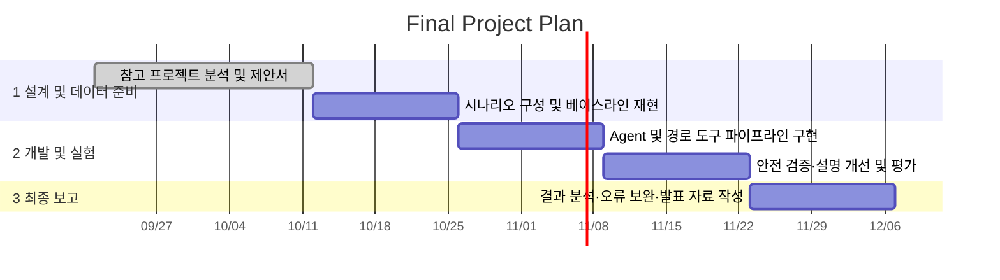

# 1. 프로젝트 개요

## 1.1. 기본 정보
- 프로젝트 제목: AI 기반 자율주행 경로 계획 및 주행 전략 설명 Agent
- 작성일자: 2026년 10월 6일
- 학번 / 이름: 20252416 / 조성관

# 2. 서론 및 배경

## 2.1. 배경
- 문제 정의: 자율주행 차량은 주변 차량·보행자·차선·신호와 도로 구조를 함께 고려해 안전하고 효율적인 경로를 선택해야 한다. 기존 경로 계획 시스템은 경로와 행동을 산출하는 데 집중하는 경우가 많아, 사용자가 선택 이유와 위험 요소를 이해하기 어렵다. 또한 LLM만으로 경로를 결정하면 사실과 다른 정보나 일관성 없는 계획이 생성될 수 있다.
- 제안 배경: 본 프로젝트는 컴퓨터 비전 및 주행 환경 데이터로 장면을 구조화하고, 지도/경로 도구가 제공하는 경로 후보를 비교하는 고수준 Agent를 제안한다. Agent는 거리·예상 시간·차선 변경·교차로·위험요소를 고려해 주행 전략을 구성하고, 선택 근거를 자연어로 설명한다. 경로 계산과 안전 검증은 전문 도구 및 규칙 모듈이 맡고 LLM은 상황 해석과 설명을 담당하도록 역할을 나눈다.

## 2.2. 기여점
- 참고 프로젝트 주제: nuPlan 자율주행 경로 계획 벤치마크, Waymo Open Dataset의 주행 환경 데이터, CARLA 자율주행 시뮬레이터, LLM 기반 차 궤적 계획 연구를 참고한다.
- 기존 프로젝트와의 차별성: 대규모 자율주행 모델이나 저수준 차량 제어를 새로 구현하는 대신, 제한된 주행 상황에서 경로 후보 비교와 구간별 전략 생성, 판단 근거 설명을 묶은 고수준 Agent를 구현한다. 도구 기반 경로 검증과 안전 규칙 검사를 추가해 LLM의 단독 판단을 제한하고, 계획과 설명을 함께 평가한다.

# 3. 상세 내용

## 3.1. 개발 목표 및 접근법

- 정량적/정성적 달성 목표:
  - 출발지·목적지·주행 조건을 입력받아 2개 이상의 경로 후보가 제공될 경우, 후보별 거리·예상 시간·주요 위험/복잡도 항목을 비교한다.
  - 각 시나리오에서 목적지까지의 구간별 주행 계획과 선택 근거를 구조화된 형식으로 출력한다.
  - 시뮬레이션/정의된 테스트 시나리오에서 경로 유효성, 안전 규칙 위반 여부, 출력 완성도 및 설명의 근거 일치 여부를 기록하고 분석한다. 정량 성능 기준은 베이스라인 실행 후 확정한다.
  - 시연 가능한 프로토타입과 반복 가능한 평가 시나리오 및 결과 보고서를 완성한다.
- 핵심 알고리즘 및 접근법:
  1. CV 모듈(예: YOLO 계열)을 사용해 이미지/영상에서 차량, 보행자, 신호등 등 객체를 탐지하거나, 제공된 구조화 환경 정보를 입력받는다.
  2. 지도/경로 모듈(OSRM 또는 사용 가능한 지도 API)이 경로 후보와 도로 정보를 제공한다. LLM이 도로 연결 관계나 좌표를 임의 생성하지 않도록 경로 후보는 도구 결과를 기준으로 한다.
  3. 후보별 거리, 예상 시간, 교차로/차선 변경 정보와 환경 위험요소를 비교해 고수준 행동을 계획한다. 안전 규칙 모듈이 신호·보행자·차선 변경 관련 제약을 검사한다.
  4. OpenAI GPT 계열 모델과 LangChain 기반 Agent Workflow가 입력 정보 및 도구 결과를 요약하고, 선택된 계획과 근거를 자연어로 설명한다.
  5. CARLA 시뮬레이션 또는 재현 가능한 정적 시나리오를 사용해 정상/위험 상황을 점검한다. 실제 차량 제어는 범위에 포함하지 않는다.

## 3.2. 시스템 아키텍처

- 파이프라인:

## 3.3. 입출력 인터페이스

- 입력 데이터 형태:
  - 출발지와 목적지: 주소/장소명 또는 위·경도 좌표
  - 주행 목적: 안전성 우선, 빠른 이동 등 선택 항목
  - 환경 정보: 640×640 RGB 이미지 또는 영상 프레임(선택 입력), 혹은 차량·보행자·차선·신호등·교차로 등의 구조화된 목록
  - 도구 정보: 경로 후보, 거리, 예상 시간, 도로/교차로 정보
- 최종 출력 형태:
  - 추천 경로 ID 및 주요 경유 구간, 총 거리와 예상 시간(도구가 제공하는 경우)
  - 구간별 행동 목록(예: 차선 유지 → 안전 확인 후 우측 차선 변경 → 감속 → 우회전)
  - 고려한 환경 정보, 주요 위험요소, 경로 선택 근거
  - 안전 규칙 검사 결과 및 데이터/도구가 제공하지 않은 정보에 대한 표시

# 4. 개발 환경

## 4.1. 데이터셋

- 데이터셋 이름: CARLA 시뮬레이션 시나리오 및 자체 구성 주행 상황 입력을 기본 평가 데이터로 사용한다. 구현 여건에 따라 nuPlan 또는 Waymo Open Dataset의 일부 공개 자료를 보조 참고/평가에 활용한다.
- 데이터셋 출처: [CARLA](https://carla.org/), [nuPlan](https://www.nuscenes.org/nuplan), [Waymo Open Dataset](https://waymo.com/open/)
- 데이터 규모: 초기 구현은 교차로, 차선 변경, 보행자/차량 위험 상황 등을 포함한 최소 10개 시나리오를 구성해 시작한다. 공개 데이터셋을 추가할 경우 실제 사용한 샘플 수와 용량을 기록한다. (계획 단계 추정치이며 확보 후 확정)
- 데이터 특징: 시나리오별 출발/목적지, 도로/경로 후보 및 환경 객체 정보를 사용한다. 객체 정보는 클래스와 위치/상태를 포함하는 구조화된 입력으로 표현하며, 이미지/영상 사용 시 탐지 결과를 비교할 수 있다. 공개 데이터 이용 조건과 라이선스를 확인한다.

## 4.2. 실행 환경

- 개발 언어 및 프레임워크: Python 3.10 이상, PyTorch, LangChain, Streamlit
- 라이브러리: OpenCV, Ultralytics YOLO(객체 탐지 사용 시), Pydantic(구조화 출력), 지도/경로 API 클라이언트, CARLA Python API(시뮬레이션 사용 시)
- 연산 환경: 일반 개발용 CPU 환경에서 Agent 및 경로 분석을 개발하고, 객체 탐지/시뮬레이션 실험은 사용 가능한 GPU 또는 Google Colab GPU를 활용한다. 구체적인 GPU와 모델 버전은 실험 환경에 맞춰 기록한다.

# 5. 수행 계획

## 5.1. 개발 일정

- 6~7주차 (2026-09-21~2026-10-11): 참고 프로젝트 분석, 요구사항/시스템 설계, 제안서 작성 및 제출
- 8~9주차 (2026-10-12~2026-10-25): 평가 시나리오 및 데이터 확보, 경로 도구 연결, 베이스라인 Agent 재현
- 10~13주차 (2026-10-26~2026-11-22): 환경 입력/도구 연동, 후보 비교·안전 검증 파이프라인 구현, 실험 및 개선
- 14~15주차 (2026-11-23~2026-12-06): 결과 분석, 오류 보완, 시연 및 기말 발표 자료 작성

# 6. 참고 문헌

- 논문: *Large Language Model Enhanced Differentiable Trajectory Planning*, arXiv:2607.10438, https://arxiv.org/abs/2607.10438
- 오픈소스 저장소/프로젝트: CARLA, https://carla.org/ ; LangChain, https://github.com/langchain-ai/langchain ; Ultralytics YOLO, https://github.com/ultralytics/ultralytics
- 데이터셋 및 벤치마크: nuPlan, https://www.nuscenes.org/nuplan ; Waymo Open Dataset, https://waymo.com/open/
- 경로 데이터/도구: OpenStreetMap, https://www.openstreetmap.org/ ; OSRM, https://project-osrm.org/
